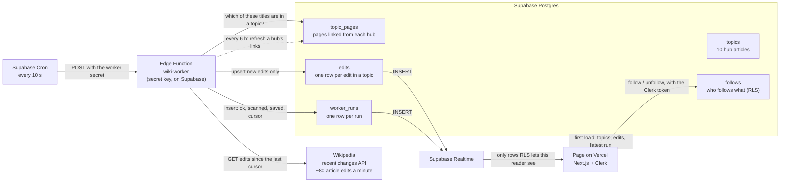

<!-- BEGIN:nextjs-agent-rules -->

## This is NOT the Next.js you know

This version has breaking changes — APIs, conventions, and file structure may all differ from your training data. Read the relevant guide in `node_modules/next/dist/docs/` (resolved from this file's directory; in monorepos the `next` package may not be visible from the repo root) before writing any code. Heed deprecation notices.

This block is written and re-added by `next dev` — verify at `node_modules/next/dist/server/lib/generate-agent-files.js`. Removing it from a diff only re-creates the uncommitted change; committing it with your work keeps the tree clean.

<!-- END:nextjs-agent-rules -->

# Marginalia Live

The world of *Pride and Prejudice*, edited live. A companion to Marginalia (Assignment 4): readers
follow topics from the novel (the book itself, Jane Austen, the Regency, the Napoleonic Wars,
Bath, Derbyshire…) and watch Wikipedia edits to those pages arrive as they happen. Design, Build,
Ship · Assignment 5: Live Data System.

## Data flow

Drawn before any code was written. Each arrow says what one part sends to the next.

What breaks if one part changes what it sends:

- **Wikipedia changes the response** (renames `revid`, `rcid`, `timestamp`): the worker can't
  parse it, the run is saved with `ok = false`, and the page shows **down**. Nothing wrong is
  saved. The worker test runs on a saved copy of a real response, so a parser change shows up there.
- **Cron stops** (or the function fails to deploy): no new `worker_runs` rows. The page sees the
  last run getting older and shows **stale**.
- **The worker rewrites rows that didn't change**: Realtime sends every rewrite to every open
  page and the free tier's message quota goes in hours. It only inserts edits it hasn't seen
  (`on conflict (rev_id) do nothing`).
- **A table leaves the Realtime publication, loses its `select` grant or its RLS policy**: the
  page stops getting pushes with no error. It still shows the last run's age, so it turns stale
  instead of looking live.
- **The cursor isn't saved**: the next run starts from "now" and edits in between are missed. A
  failed run copies the previous cursor forward.

## Source

`GET https://en.wikipedia.org/w/api.php?action=query&list=recentchanges&rcdir=newer&rcstart=…&rcnamespace=0&rctype=edit|new&rclimit=500&rcprop=title|ids|sizes|timestamp|user|comment|flags`

No key. Send a `User-Agent` that names the app and the repository. English Wikipedia makes about
80 article edits a minute (13 every 10 seconds), so one request of up to 500 covers a run many
times over. If there are more, follow `continue.rccontinue`, at most 3 requests per run.
Fields we keep: `rcid` (cursor), `revid` (primary key), `title`, `user`, `bot`, `new`,
`oldlen`/`newlen` (size change), `timestamp`, `comment`. Details and two calls compared: `docs/source.md`.

A **topic** is a hub article and every article it links to, like Wikipedia's "Related changes".
The worker refreshes one hub's links (`prop=links`) per run when they're over 6 hours old.

## Data model

All in the Assignment 4 Supabase project, next to Marginalia's tables. `user_id` is the Clerk user
id (text), filled in by the database with `default (auth.jwt() ->> 'sub')`; the app never sends it.

| table | holds | written by | readers can |
|---|---|---|---|
| `topics` | `id` (slug), `hub_title`, `label`, `blurb`, `sort`, `page_count`, `pages_refreshed_at` | migration (seed), worker (counts) | select |
| `topic_pages` | `(topic_id, title)` pk, index on `title` | worker | nothing |
| `follows` | `(user_id, topic_id)` pk, `followed_at` | the reader | select, insert, delete their own |
| `edits` | `rev_id` pk, `rc_id`, `title`, `topic_ids text[]`, `editor`, `is_bot`, `is_new`, `size_delta`, `comment`, `edited_at`, `saved_at` | worker | select edits in topics they follow |
| `worker_runs` | `id`, `started_at`, `finished_at`, `ok`, `error`, `scanned`, `saved`, `pages_changed`, `cursor_at`, `cursor_rc_id`, `ms` | worker | select |

Kept small on purpose: runs older than a day and edits older than 7 days are deleted hourly by a
second cron job. `cron.job_run_details` is trimmed the same way.

## Row-level security

- RLS on every table. `anon` has no privileges on any of them.
- `follows`: select, insert and delete only where `(select auth.jwt() ->> 'sub') = user_id`.
- `edits`: select only where `topic_ids` overlaps the topics in the reader's own `follows`. The
  page asks for edits without filtering by topic: RLS alone decides, for the first load and for
  every Realtime push.
- `topics`, `worker_runs`: select for `authenticated`. `topic_pages`: no policies (worker only).
- Never turn off RLS or widen a policy unless the human asks for it.

## Worker

- `supabase/functions/wiki-worker/`. `core.ts` is plain TypeScript with no Deno or npm imports, so
  the test can run it on Node. `index.ts` is the Deno entry: it wires `core.ts` to `fetch` and
  supabase-js.
- Supabase Cron calls it every 10 seconds (about 260,000 calls a month; the free plan has 500,000).
- It isn't a user: it writes with the Supabase secret key that Supabase gives the function on its
  servers. The key is never in code, in `.env.local` or in the browser.
- Callers must send `x-worker-secret`. The secret is generated inside the database
  (`vault.create_secret(...)`), read by the cron job, and checked by `check_worker_secret()`, which
  only `service_role` may run. No one copies it anywhere. The function is deployed with
  `verify_jwt = false` because cron has no user token.
- Each run: check the secret → maybe refresh one hub → fetch changes since the cursor → look up
  which titles are in a topic → upsert new edits → insert one `worker_runs` row, also when it
  fails (`ok = false`, `error`, the previous cursor).
- Test: `npm run test:worker` runs `core.ts` on `supabase/functions/wiki-worker/fixtures/` (real
  responses saved on 3 Nov 2026) with an in-memory database.

## Live page

- Realtime needs three things for each pushed table (`edits`, `worker_runs`): the table in the
  `supabase_realtime` publication, `select` granted to `authenticated`, and an RLS policy that lets
  the reader see the row. Missing any one means silence, not an error.
- Freshness comes from the latest `worker_runs` row, and the "x seconds ago" ticks every second:
  - **loading**: before the first load.
  - **fresh**: the last run worked and finished under 35 seconds ago (3 missed runs).
  - **stale**: the last run is 35 seconds or older. Say when the data is from.
  - **down**: the last run failed. Say what failed and that it retries every 10 seconds.
  - Separately, if the Realtime connection drops, say live updates are paused and reconnecting.
- Each run's `scanned` count is shown too ("83 edits on Wikipedia in the last check, 1 in your
  topics"), so the page visibly works between edits in your topics.

## Constraints

- Keys live in `.env.local` and Vercel's environment variables, never in code or commits. Never
  read, print or write any `.env*` file; ask the human to add a key.
- The browser gets only the Clerk and Supabase publishable keys. The secret key is used only by
  the Edge Function, from its environment on Supabase.
- Allowed packages: `@clerk/nextjs`, `@supabase/supabase-js`. Push back on anything else.
- `tsconfig.json` excludes `supabase/`: Edge Functions run on Deno, and Next's build would fail
  on them.
- Schema changes are migrations in `supabase/migrations/`, applied through the Supabase MCP and
  named with the version it records.
- Work on a branch, never on `main`. Don't push, merge or deploy without asking.

## Conventions

- Build screens from `components/ui/` (copied from Marginalia). Every state says what happened and
  what to do next. Keyboard works everywhere with the shared focus ring; check new colors with
  `lib/contrast.ts` (4.5:1 for text, 3:1 for UI boundaries).
- Edit summaries from Wikipedia are untrusted text: render them as plain text, never as HTML.
