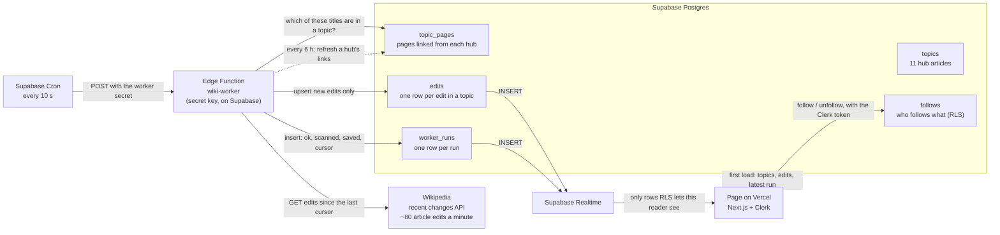

# Marginalia Live

**The world of *Pride and Prejudice*, edited now.** Follow topics from the novel (the book
itself, Jane Austen, the Regency, the Napoleonic Wars, Bath, Derbyshire…) and watch Wikipedia
edits to their pages arrive as they happen, without refreshing.

- **Live:** https://marginalia-live.vercel.app
- **Code:** https://github.com/Rogernarten/marginalia-live
- Companion to [Marginalia](https://marginalia-fullstack-eight.vercel.app) (Assignment 4), the
  reading guide. Design, Build, Ship · Assignment 5: Live Data System.

## How data moves

Drawn before any code was written, in the [first commit](https://github.com/Rogernarten/marginalia-live/commit/11a2ec7); since then only the topic count changed, when England was added. [AGENTS.md](AGENTS.md) has what breaks if a part changes.



## What it's made of

| | |
|---|---|
| **Source** | Wikipedia's [recent changes](https://www.mediawiki.org/wiki/API:RecentChanges), no key. English Wikipedia makes about 80 article edits a minute. In the hour measured at 2 PM on 3 Nov, 34 landed in the first 10 topics (17 in London); England, added after, gets about as many as London. Two calls compared in [docs/source.md](docs/source.md). |
| **Topics** | A hub article and every article it links to (Wikipedia's "Related changes"): 11 hubs, from *Pride and Prejudice* (282 pages) to London (1,939). "Follow all" follows them in one go. |
| **Worker** | [`supabase/functions/wiki-worker`](supabase/functions/wiki-worker): an Edge Function that Supabase Cron calls every 10 seconds. It reads changes since the last cursor, keeps those to pages in a topic, inserts only edits it hasn't saved (`on conflict (rev_id) do nothing`) and records every run in `worker_runs`, failed ones too. It writes with the secret key Supabase gives it on its servers. |
| **Data** | [Migrations](supabase/migrations/): `topics`, `topic_pages`, `follows`, `edits`, `worker_runs`, RLS on all five. You see only your own follows, and only edits in topics you follow: the page never filters, RLS does. |
| **Live page** | Supabase Realtime pushes new edits and new runs. Freshness from the newest run, counting up every second: **fresh** (checked under 35 s ago), **stale** (three missed runs: says when the edits are from), **down** (the last run failed: says why), plus loading, not started, no topics yet, no edits yet, and a dropped Realtime connection. |
| **Test** | `npm run test:worker`: the worker on real responses saved on 3 Nov 2026 (500 changes, 2 in a topic) with an in-memory database. It checks what gets saved, that a second run saves nothing, that the cursor moves, and that an outage or a changed response saves nothing and is recorded as a failed run. |

## Run it

```bash
npm install
# .env.local (create it yourself; the agent can't read it):
#   NEXT_PUBLIC_CLERK_PUBLISHABLE_KEY, CLERK_SECRET_KEY
#   NEXT_PUBLIC_SUPABASE_URL, NEXT_PUBLIC_SUPABASE_PUBLISHABLE_KEY
npm run dev
npm run test:worker
```

The worker and its schedule are deployed to Supabase through the Supabase MCP server; the secret
key never leaves Supabase.

## What testing and the logs found

- **The edit rate was wrong in the plan.** I first wrote about 80 edits every 10 seconds. The first
  deployed run, reading the minute before it, scanned 96: it's about 80 a minute.
- **The worker test caught a wrong count.** I expected 284 pages linked from *Pride and
  Prejudice*; it's 282, because two links go to articles that don't exist and the worker skips
  them by design. The test now checks that too.
- **Pushes arrived empty.** Each Realtime message had `errors: ["Error 401: Unauthorized"]` and
  no row, so the page said "The last check failed, NaN days ago". The page had joined Realtime
  with the publishable key before Clerk's token was in place. It now joins as the reader.
- **The page stopped after the server closed its channel** (`phx_close`, once). It now joins again
  after 2 seconds, checked by faking a `phx_close` through a proxied socket.
- **After sleep, the page came back with an expired token** ("InvalidJWTToken: Token has expired
  516 seconds ago"). It now asks for a new token as soon as Realtime refuses one, instead of at
  the next heartbeat.
- **In development the page said "Live updates paused" at once.** React mounts twice there, and
  `channel("live")` handed back the channel still closing from the first mount. Each join now
  uses a new channel name.

## Free tier

- Edge Functions: a run every 10 seconds is about 260,000 calls a month (the free plan has 500,000).
- Realtime: only new edits (about 50 an hour across all topics) and one run row every 10 seconds are pushed, so an
  open page gets about 6 messages a minute.
- The tables stay small: runs older than a day and edits older than a week are deleted hourly.
